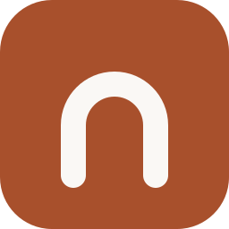

<div align="center">
  
  <h1>Nook</h1>
  <p><strong>A notebook that talks to nobody.</strong></p>
  <p>
    <a href="https://maxgfr.github.io/nook/">Open the app</a> ·
    <a href="#project-status">Project status</a> ·
    <a href="#what-nook-protects-and-what-it-does-not">Security</a>
  </p>
</div>

---

Nook is a note-taking tool that runs entirely inside your browser. No account,
no server, no synchronisation. Your notes are encrypted on your own machine,
and the page is configured so that no outgoing request is possible at all.

It is a static site on GitHub Pages: the server sends files and never has
anything to receive back.

## The promise, and how it is kept

| Promise                           | Mechanism                                                                                   |
| --------------------------------- | ------------------------------------------------------------------------------------------- |
| Nothing leaves your machine       | `connect-src 'none'` in the CSP — the browser refuses every outgoing request                |
| Nobody disabled that by accident  | CI inspects the published bundle and fails if network-capable code gets in ([the guard][g]) |
| Your notes are unreadable on disk | AES-GCM-256 with a non-extractable key, never exposed to JavaScript                         |
| Everything really can be erased   | Database, caches, service worker and storages destroyed, then an inventory of what remains  |
| It works offline                  | Precached and installable as a PWA                                                          |

[g]: scripts/check-no-network.mjs

## What Nook protects, and what it does not

By default the encryption key is generated on the device and kept in the
browser in a form JavaScript cannot read.

**What that protects:** anyone who copies your disk, your browser profile or a
backup gets nothing but unusable bytes.

**What it does not protect:** anyone who opens _your_ browser with _your_
unlocked session gets exactly the rights you have.

**Turning on a passphrase closes that gap.** Everything is re-encrypted under a
new key derived with Argon2id, the old key is destroyed, and the vault locks
itself after 15 idle minutes. There is no recovery — no server holds a copy —
so Nook makes you export before it will let you switch.

## Project status

Nook is built in phases, and each one leaves a deployable repository.

| Phase | Content                                                            | Status  |
| :---: | ------------------------------------------------------------------ | ------- |
|  P0   | Foundations, CI, Pages deployment, network guard, design tokens    | ✅ done |
|  P1   | Encrypted vault: storage, AES-GCM envelopes, key lifecycle, wiping | ✅ done |
|  P2   | Block editor, page tree, autosave                                  | ✅ done |
|  P3   | Wikilinks, backlinks, tags, search, command palette, daily notes   | planned |
|  P4   | Passphrase, auto-lock, encrypted export                            | planned |
|  P5   | Databases: typed properties, table / kanban / calendar views       | planned |
|  P6   | Graph view, version history, images, printing                      | planned |

Today Nook can create pages, nest them, write in them, link them with
`[[wikilinks]]`, tag them, find any of them from `⌘K` — including by a word
buried in the text — lock the whole vault behind a passphrase, keep structured
databases with table, board and calendar views, and erase itself in a way you
can check.

### A feature removed on purpose

The editor's emoji picker downloads its data **and its images** from a CDN at
runtime. The CSP would block those requests and the menu would be silently
empty — the worst of both worlds. Rather than switching it off with an option,
the library is [replaced at build time][stub], so the network code is not
merely unreachable: it is never served. Emoji typed on the system keyboard work
as usual.

[stub]: src/ui/editor/emoji-mart-absent.ts

## Architecture

Two halves, separated by a rule that CI enforces.

```
src/core/   Plain TypeScript — storage, encryption, model, search
src/ui/     React — components, editor, layout
```

The core imports neither React nor the editor; the interface never touches
IndexedDB or WebCrypto. That boundary is not a style convention —
[a test enforces it](src/core/architecture.test.ts) and breaks CI when it is
crossed. It is what lets the whole domain be tested without a browser, and the
interface be rebuilt without touching the data.

## Development

```bash
pnpm install
pnpm dev        # development server
pnpm test       # core tests, no browser
pnpm verify     # types, lint, tests, build, network guard
pnpm smoke      # writes a note in a real browser, reloads, checks it survived
```

`pnpm verify` is exactly what CI runs.

## Host your own

1. Fork this repository.
2. Settings → Pages → Source: **GitHub Actions**.
3. Push to `main`.

The sub-path is derived from the repository name, so renaming your fork is
enough — there is nothing to change in the code.

## Licence

[MIT](LICENSE).
